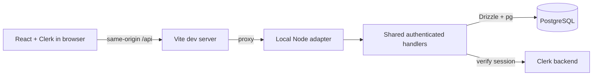

# Chronostasis architecture

Updated: 2026-10-26.

## Scope and deployment status

Chronostasis is a mobile-first application foundation: a React client signs in with Clerk, calls a TypeScript API, and persists an application user and catalogue in PostgreSQL. Focus timing, chest opening, loot selection, and owned inventory are not implemented. The repository now contains a Vercel build runner for shared Integration and persistent Production Neon databases; account settings and hosted behavior still need owner verification. PWA packaging and Capacitor/iOS packaging are future work.

## Workspace

The pnpm monorepo uses TypeScript, React, Vite, Tailwind CSS, Vercel Functions adapters, Neon-compatible PostgreSQL, Drizzle, Clerk, Vitest, Playwright, and Docker Compose.

- `apps/web` contains the Vite React application, Clerk provider and auth routes, protected Focus/Inventory placeholders, typed API client, and thin Vercel Function entrypoints. `apps/web/server/api.ts` composes the server runtime for those entrypoints.
- `apps/api` is the local Node HTTP adapter. It loads local environment configuration and serves the same shared API handlers as the Vercel adapters.
- `packages/api` owns server configuration, Clerk session verification, shared Web Request/Response handlers, database composition, and the Node/Vercel adapters.
- `packages/contracts` defines browser-safe Zod response schemas and inferred types.
- `packages/db` owns the Drizzle schema, migrations, PostgreSQL pool, repository operations, and transactional catalogue seed.
- `tests/e2e` contains signed-out and authenticated Playwright browser tests.
- `scripts` contains the full local verification runner, Git hook tooling, isolated database/Playwright test runners, and the hosted deployment target validator/build runner.

Workspace libraries emit declarations for TypeScript project references. Type-aware ESLint and strict source type checking run across the workspace. `skipLibCheck` is limited to database, API, browser, and tooling projects to work around errors in installed Drizzle/Clerk declarations; contracts and the local runtime retain declaration checking.

## Local runtime and request flow

`docker compose up --build -d --wait` starts the dependency initializer, PostgreSQL, database migration/seed initializer, local API, and Vite frontend in dependency order. Only the frontend is published to the host, bound to loopback; the API binds to `0.0.0.0` inside the private Compose network and its port is not published. Optional host-run API development defaults to `127.0.0.1` (`API_HOST`); the Compose service explicitly overrides it. Postgres uses a named volume. Source mounts support frontend/API hot reload, while a container-owned dependency volume and image-owned workspace symlinks keep host dependencies and `.env` out of application containers.

The browser flow is:

The frontend obtains Clerk bearer tokens and calls `POST /api/me` to idempotently create the current application user, then `GET /api/me` to confirm the persisted identity. “Account ready” requires both responses to refer to the same user. Requests are scoped to the active user/session and cancelled when the relevant component unmounts.

The local Node adapter and Vercel Functions entrypoints convert requests to the same Web `Request`/`Response` handlers. Both preserve request method, headers, and raw body bytes, enforce a 64 KiB body limit, and return the same safe JSON error contract. The hosted runner typechecks function entrypoints before the Vite build. Its app-level `tsconfig.json` repeats the shared compiler options because Vercel does not follow TypeScript project references. Hosted invocation has not been verified.

## Authentication and API

Clerk is the only identity provider. The backend verifies session signatures, issuer, expiry, allowed frontend origin, and session status before database access. The verified Clerk subject is the only identity used for persistence; request-body fields do not select a user. Missing or invalid credentials return 401. Responses containing user data or errors are not cached. Unexpected failures do not expose tokens, configuration, SQL, or stack traces.

- `GET /api/health` probes the database and returns a safe 200 or 503 response.
- `POST /api/me` authenticates and conflict-safely initializes the persisted application user.
- `GET /api/me` authenticates and reads the persisted application user.

The browser receives only the Clerk publishable key. Clerk's secret key is used by the server and E2E runner, never exposed through a Vite variable or frontend image. Locally and in Production, `CLERK_AUTHORIZED_PARTIES` is an explicit allowlist. On Vercel Preview, the API builds the allowlist from the exact deployment and branch origins in `VERCEL_URL` and `VERCEL_BRANCH_URL`; the static variable may be unset in Preview. This allows generated Preview URLs to work without wildcard origins or per-ticket dashboard edits. Vercel system environment variables must be enabled. Use Clerk Development keys for Preview and Production keys for Production. There is no authentication bypass or test-only login endpoint.

## Data model

`0000_bootstrap.sql` creates:

- `users`: UUID primary key, unique non-null Clerk subject, and timezone-aware creation/update timestamps.
- `items`: stable text primary key and display name. The initial seed defines Rusty key, Copper ring, and Blue gem.

`0001_chest_catalogue.sql` adds a normalized loot catalogue:

- `chests`: stable text primary key and name. The initial seed adds `basic-chest` / Basic chest.
- `chest_items`: foreign keys to `chests` and `items`, with a composite primary key `(chest_id, item_id)`.

The seed upserts item and chest definitions and inserts missing eligibility links in one transaction. Additional chest types or links can be added without schema changes. The three item links describe eligible rewards, not chest contents: the future chest-opening flow is intended to award exactly one item. There is no owned-chest, opening-history, reward probability, focus-session, or inventory model yet.

Database pools are bounded. Hosted connections require certificate verification; local Compose connections use the local non-TLS server. Runtime configuration prefers `DATABASE_URL`, then `NEON_DATABASE_URL` or `NEON_POSTGRES_URL`; migrations prefer `MIGRATION_DATABASE_URL`, then an explicit `DATABASE_URL`, then `NEON_DATABASE_URL_UNPOOLED` or `NEON_POSTGRES_URL_NON_POOLING`, and finally the selected runtime URL. These include the variable names supplied by Vercel's Neon integration with the `NEON_` prefix. Compose uses fixed local-only database credentials and destinations so a host environment variable cannot redirect initialization to another database.

## Styling and mobile layout

The web workspace registers the official Tailwind CSS Vite plugin. Components use Tailwind utilities; `apps/web/src/styles.css` imports Tailwind, defines shared `@theme` tokens, and contains document-level base styles. Vite generates styles in development and production builds. The signed-in Focus and Inventory routes are mobile-first placeholders; no timer or loot behavior is simulated.

## Verification and isolation

GTS is authoritative for JavaScript and TypeScript formatting and general lint rules. `pnpm format:check` verifies formatting and `pnpm format:fix` applies GTS fixes. The ESLint flat config layers the full GTS config with the workspace's strict type-aware TypeScript rules, React Hooks rules, and browser/server import restrictions. `pnpm lint` is a non-fixing lint check; `pnpm typecheck` remains the separate TypeScript project check.

The staged-file pre-commit hook delegates to GTS through the repository's `.githooks` path; `commit-msg` continues to add or validate the ticket prefix. `pnpm verify:all` is the local, serial gate for GTS formatting, lint, typecheck, unit tests, PostgreSQL integration tests, hook tests, authenticated Playwright E2E, and production build. Jenkins is not configured; a later pipeline can call this same command.

The focused root checks are `pnpm lint`, `pnpm format:check`, `pnpm typecheck`, `pnpm test:unit`, `pnpm test:integration`, `pnpm test:hooks`, `pnpm test:e2e`, and `pnpm build`. `pnpm verify:all` runs the full set including GTS formatting.

- Unit tests cover contracts, server configuration, authentication, request/response behavior, adapter parity, and frontend API/account states.
- Integration tests use a unique Compose project and isolated `chronostasis_test` database volume for real migrations, user upserts, and catalogue constraints. They clean up only their own resources and do not reset development data.
- Hook tests use temporary repositories and exercise pre-commit setup and the ticket-prefix hook without creating test commits in Chronostasis.
- Playwright tests run signed-out and authenticated browser flows in Chromium at a mobile viewport. The authenticated suite requires a dedicated Clerk development test user and fails with missing setting names rather than silently skipping coverage. Each invocation creates and removes its own Compose project and database/dependency volumes.
- The verified Task 8 run passed 104 unit tests, 13 PostgreSQL integration tests, 37 hook tests, and four authenticated/setup/signed-out browser tests. Lint, strict type checking, the production build, and Compose configuration validation also passed. Exact per-task outcomes are recorded in the implementation plan.

## Hosting boundary

The hosted topology is a static Vite build and Vercel Functions connected to Neon PostgreSQL. `apps/web/api` contains the Vercel adapters and routing configuration. `scripts/deploy-build.mjs` validates the Vercel environment, branch, Neon URL pair, and configured direct-host marker before running the function typecheck and app build. Production deployments prepare the persistent Production branch. A Vercel ignored-build rule skips automatic deployments of the `integration` branch; an owner can explicitly redeploy its selected commit to prepare the persistent Integration branch. Other Preview builds share Integration and skip preparation. A direct PostgreSQL connection and session advisory lock serialize migrations and catalogue seeding. Local builds and Docker Compose remain separate from this hosted runner. Service settings and hosted API/database behavior remain unverified until exercised. A future PWA or Capacitor shell can reuse the React client and HTTPS API, with its own platform/auth callback work.
