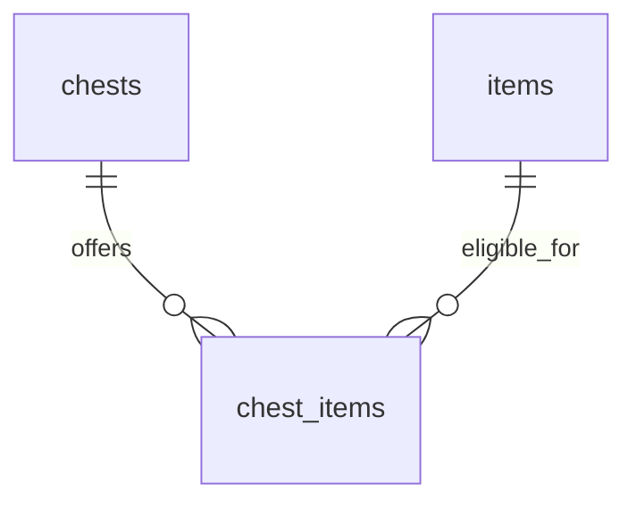

# Chronostasis architecture

Updated: 2026-10-24.

This document separates the current implementation from the intended bootstrap architecture. It was created at the user's request during the Task 3 design update; planned components are not claims of implemented or verified behavior.

## Current implementation

- Tasks 1 and 2 are committed on `maintenance/CHR-5`: Git ticket-prefix workflow, pnpm workspace, strict TypeScript/ESLint, React/Vite, and Tailwind CSS.
- Task 3's existing user/item database foundation is implemented but unstaged. It includes Postgres, Drizzle migrations, idempotent item seeding, user upsert/read operations, contracts, and isolated database tests.
- The normalized chest catalogue is implemented in the unstaged Task 3 changes, including an additive migration, transactional catalogue seed, and real-Postgres tests. The authorized independent bug review found one connection URL override defect; it is fixed, regression-tested, and confirmed resolved on follow-up. Security Review was skipped for this step as requested.
- Authentication, the local HTTP API, Vercel Function adapters, containerized frontend, and Playwright smoke tests remain later bootstrap tasks. No Vercel/Neon deployment or iOS package exists.

## Runtime boundaries

Today, `pnpm dev` serves a disconnected React scaffold through Vite. The current Compose configuration starts internal Postgres and a one-shot migration/seed initializer. There is no frontend-to-database connection yet.

The intended completed bootstrap flow is React → same-origin HTTP `/api` → shared authenticated TypeScript handlers → Drizzle/pg → Postgres. A small local Node adapter will serve the handlers during development; thin Vercel adapters will serve the same handlers when separately deployed. Clerk will authenticate the frontend and provide server-verified session tokens. The backend derives ownership from the verified identity and holds database credentials.

Vercel is the intended frontend/API host, and Neon is the intended hosted Postgres provider. Both belong to the separate deployment ticket. Future Capacitor packaging can reuse the React frontend and HTTPS API; PWA/native packaging is not part of CHR-5.

## Workspace responsibilities

- `apps/web`: React/Vite frontend. Tailwind's Vite plugin generates styles from component utilities; `src/styles.css` holds the import, shared theme tokens, and document-level base styles.
- `packages/contracts`: browser-safe Zod response schemas and inferred types.
- `packages/db`: server-only schema, connection configuration, migrations, seeds, and repository code. It uses `pg` with bounded pooling and strict certificate verification for hosted destinations.
- `apps/api` and `packages/api`: planned local runtime and shared API/authentication code; not created yet.
- `scripts`: hook installation/processing/tests and a Docker integration-test runner.
- `docs/superpowers`: design requirements and a task-per-commit implementation plan. Prepared subjects do not bypass unstaged review.

Contracts/database emit declaration files for TypeScript project references. Only the database package skips third-party declaration checking because stable Drizzle includes optional-driver declaration errors; its source code remains strictly checked.

## Implemented database foundation

The original `0000_bootstrap.sql` establishes:

- `users`: UUID primary key, unique non-null Clerk subject, timezone-aware creation/update timestamps. Public user responses expose only UUID and Clerk subject.
- `items`: stable text primary key and non-null display name. Three initial definitions are Rusty key, Copper ring, and Blue gem.

User initialization uses one conflict-safe upsert, preserving the UUID on retries and concurrent initialization. The newer `0001_chest_catalogue.sql` adds the normalized chest catalogue described below without rewriting the original migration. Seeding now upserts the complete catalogue transactionally.

## Normalized chest catalogue

The user requested one initial chest type with room for more types later. The schema includes two additional catalogue tables:

- `chests`: stable text primary key `id` and non-null `name`. Seed `basic-chest` / Basic chest. The schema permits additional chest definitions without a migration or singleton constraint.
- `chest_items`: non-null `chest_id` and `item_id` foreign keys, with composite primary key `(chest_id, item_id)`. Restrictive foreign keys prevent silent deletion of referenced definitions. Link the basic chest to the three existing item definitions.

The target relationships are:

Chest metadata exists only on `chests`, item metadata only on `items`, and eligibility only on junction rows. Do not duplicate names on links, store item IDs in arrays/JSON, or put a single chest ID on an item: the same item can be eligible for multiple chest types.

A chest definition is not an owned chest instance or a reward event. Three eligible item links form a loot pool; the later opening feature still awards exactly one item. Ownership, focus sessions, opening history, reward probabilities, and inventory are separate future work and must not be inferred from catalogue rows.

The extension uses the additive `0001_chest_catalogue.sql` migration; the original migration is unchanged. `seedCatalogue` uses one transaction to upsert item definitions, upsert chest definitions, and insert missing eligibility links. Reseeding preserves additional definitions/links. A forced link failure was tested to roll back earlier item updates.

## Local data and environment

Compose pins Node 24.20.0 and Postgres 17.11 by image digest. Application image processes run as the non-root `node` user. The database has no host-published port; its data lives in a project-owned named volume. The initializer waits for database health and stops before seeding if migration fails.

Compose fixes its local database destination so a host production URL cannot redirect initialization. Host CLI operations read explicit `DATABASE_URL` and optional `MIGRATION_DATABASE_URL`; they do not depend on Clerk or automatically load `.env`. `.env` and local execution artifacts are excluded from Git and the Docker build context.

`docker compose down` retains development data. Deleting the development volume is an explicit reset, never an integration-test prerequisite.

## Verification and remaining work

Unit tests cover public contracts, safe database environment validation, isolated test destination checks, and emitted TLS settings. Real Postgres integration tests cover user persistence/concurrency/isolation and migration/item-seed repeatability. Hook tests use temporary repositories. The database slice includes 29 unit tests, 13 real-Postgres integration tests, and 37 hook tests. Lint, type checking, and the production build are also required before commit.

The integration runner creates a unique Compose project with its own `chronostasis_test` database and volume, then cleans up only that invocation's resources. Destination validation rejects the development `db` host, remote hosts, other database names, and an application database destination. Tests do not truncate or reset the developer database.

Chest integration coverage verifies initial catalogue counts, both foreign keys, composite-key uniqueness, restricted deletion, one item linked to multiple chest types, idempotent reseeding that preserves later definitions, and transactional rollback. Separate Compose verification checks additive upgrade from the earlier database image and retention across container recreation; its result is recorded in the implementation plan.

After the complete bootstrap is implemented, reconcile this document with the actual API/authentication/runtime wiring and verification outcomes. Final Bugbot/Security Review runs need user permission, and ticket completion requires passing checks, resolved or explicitly ignored findings, and the user's explicit completion approval.
