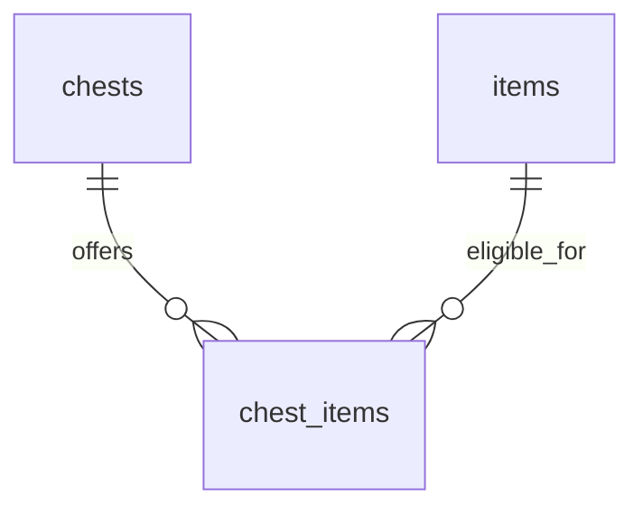

# Chronostasis architecture

Updated: 2026-10-25.

This document separates the current implementation from the intended bootstrap architecture. It was created at the user's request during the Task 3 design update; planned components are not claims of implemented or verified behavior.

## Current implementation

- Tasks 1 and 2 are committed on `maintenance/CHR-5`: Git ticket-prefix workflow, pnpm workspace, strict TypeScript/ESLint, React/Vite, and Tailwind CSS.
- Task 3 is committed as `7dc32f0`. It includes Postgres, Drizzle migrations, idempotent item seeding, user upsert/read operations, contracts, and isolated database tests.
- The normalized chest catalogue is implemented in Task 3, including an additive migration, transactional catalogue seed, and real-Postgres tests. The authorized independent bug review found one connection URL override defect; it is fixed, regression-tested, and confirmed resolved on follow-up. Security Review was skipped for this step as requested.
- Task 4 adds Clerk-backed shared handlers, a local HTTP API, Vercel Function adapters, and a health-gated API container. Task 4 is committed as `6cfd5f3`. Task 5 adds the Clerk frontend flow, protected mobile shell, typed client, and full Compose startup with hot reload; it is committed as `f9de4ac`. Task 6 adds isolated signed-out/authenticated Playwright projects, a Clerk session setup project, and a unique Compose/Postgres test stack.

## Runtime boundaries

The frontend now loads Clerk, obtains bearer session tokens, initializes the application user, and reads that same user back through the API before displaying account-ready status. Compose synchronizes dependencies, starts Postgres, initializes its schema/catalogue, starts the API, then Vite. Only Vite is host-published on loopback.

The implemented runtime flow is React → same-origin HTTP `/api` → shared authenticated TypeScript handlers → Drizzle/pg → Postgres. A local Node adapter now serves the shared handlers; thin Vercel adapters are prepared for later deployment. The backend uses Clerk’s real verifier for bearer sessions. The frontend uses Clerk’s React provider and prebuilt sign-in/sign-up components, with React Router in declarative mode. The backend derives ownership from the verified identity and holds database credentials.

Vercel is the intended frontend/API host, and Neon is the intended hosted Postgres provider. Both belong to the separate deployment ticket. Future Capacitor packaging can reuse the React frontend and HTTPS API; PWA/native packaging is not part of CHR-5.

## Workspace responsibilities

- `apps/web`: React/Vite frontend, Clerk provider/auth routes, protected mobile placeholders, and typed HTTP client. Its account gate requests a token for POST, then another for GET, verifies the same returned user, and handles cancellation/retry. Tailwind's Vite plugin generates styles from component utilities; `src/styles.css` holds the import, shared theme tokens, and document-level base styles.
- `packages/contracts`: browser-safe Zod response schemas and inferred types.
- `packages/db`: server-only schema, connection configuration, migrations, seeds, and repository code. It uses `pg` with bounded pooling and strict certificate verification for hosted destinations.
- `apps/api`: Node listener, root environment loading, bounded HTTP timeouts, and shutdown.
- `packages/api`: validated server settings, Clerk verification, injected shared handlers, real database composition, and Node/Vercel adapters.
- `apps/web/api`: thin Vercel entrypoints; `apps/web/server/api.ts` lazily reuses the real runtime. The SPA fallback excludes all `/api` paths.
- `scripts`: hook installation/processing/tests and a Docker integration-test runner.
- `docs/superpowers`: design requirements and a task-per-commit implementation plan. Prepared subjects do not bypass unstaged review.

Workspace libraries emit declarations for TypeScript references. Database/API/browser-app/tooling projects skip third-party declaration checking because the installed Drizzle/Clerk declarations contain optional-module, React JSX namespace, and exact-optional-property errors. Source remains strictly checked, and contracts/local-runtime declaration checking stays enabled.

## Implemented HTTP and authentication flow

The local Node runtime and Vercel entrypoints both convert requests into the same Web `Request`/`Response` handler. Conversion preserves method, URL, headers, and raw body bytes; both adapters reject bodies above 64 KiB before dispatch, including chunked input. Vercel's lazy parsed-body getter is never accessed. Local HTTP request/header timeouts bound stalled clients.

`GET /api/health` probes Postgres and returns safe 200/503 JSON. `POST /api/me` verifies the Clerk bearer session and upserts only its verified `sub`; `GET /api/me` reads that subject's row. Body/query identity never determines ownership. The verifier checks signatures, expiry, expected issuer, and allowed frontend origins, and rejects pending sessions. User/error responses are not cacheable. Unsupported methods receive 405 with `Allow`; missing routes receive 404. Unexpected failures expose no SQL, token, or configuration values.

Production composition always uses the real Clerk SDK and Drizzle repository. Unit tests inject dependencies or replace the SDK/JWKS boundary; there is no shipped development authentication bypass. The browser imports only public contracts and the typed HTTP client. Account synchronization aborts pending requests on unmount; a user/session key prevents responses for an old identity from unlocking the new identity’s UI. “Account ready” requires both initialization and a matching persisted read.

## Implemented database foundation

The original `0000_bootstrap.sql` establishes:

- `users`: UUID primary key, unique non-null Clerk subject, timezone-aware creation/update timestamps. Public user responses expose only UUID and Clerk subject.
- `items`: stable text primary key and non-null display name. Three initial definitions are Rusty key, Copper ring, and Blue gem.

User initialization uses one conflict-safe upsert, preserving the UUID on retries and concurrent initialization. The newer `0001_chest_catalogue.sql` adds the normalized chest catalogue described below without rewriting the original migration. Seeding now upserts the complete catalogue transactionally.

## Normalized chest catalogue

The user requested one initial chest type with room for more types later. The schema includes two additional catalogue tables:

- `chests`: stable text primary key `id` and non-null `name`. Seed `basic-chest` / Basic chest. The schema permits additional chest definitions without a migration or singleton constraint.
- `chest_items`: non-null `chest_id` and `item_id` foreign keys, with composite primary key `(chest_id, item_id)`. Restrictive foreign keys prevent silent deletion of referenced definitions. Link the basic chest to the three existing item definitions.

The target relationships are:

Chest metadata exists only on `chests`, item metadata only on `items`, and eligibility only on junction rows. Do not duplicate names on links, store item IDs in arrays/JSON, or put a single chest ID on an item: the same item can be eligible for multiple chest types.

A chest definition is not an owned chest instance or a reward event. Three eligible item links form a loot pool; the later opening feature still awards exactly one item. Ownership, focus sessions, opening history, reward probabilities, and inventory are separate future work and must not be inferred from catalogue rows.

The extension uses the additive `0001_chest_catalogue.sql` migration; the original migration is unchanged. `seedCatalogue` uses one transaction to upsert item definitions, upsert chest definitions, and insert missing eligibility links. Reseeding preserves additional definitions/links. A forced link failure was tested to roll back earlier item updates.

## Local data and environment

Compose pins Node 24.20.0 and Postgres 17.11 by image digest. Application image processes run as the non-root `node` user. The database has no host-published port; its data lives in a project-owned named volume. The initializer waits for database health and stops before seeding if migration fails; the API waits for initializer success and probes its own database connection for health. The API is internal on port 3001. The frontend waits for API health and proxies `/api` to it, preserving the browser origin. Its container receives only the public Clerk key and proxy target, with no secret/test-password environment or `.env` mount.

Compose fixes its local database destination so a host production URL cannot redirect initialization. Host CLI operations read explicit `DATABASE_URL` and optional `MIGRATION_DATABASE_URL`; they do not depend on Clerk or automatically load `.env`. `.env` and local execution artifacts are excluded from Git and the Docker build context.

A container-owned `dependencies` volume holds the shared pnpm virtual store. Workspace dependency symlinks remain in the image, so host `node_modules` cannot leak into containers. Source is mounted read-only for frontend/API hot reload. After a dependency change, `docker compose down` followed by `docker compose up --build -d --wait` lets `deps-init` synchronize the dependency volume before the application starts.

`docker compose down` retains development data. Deleting the development volume is an explicit reset, never an integration-test prerequisite.

## Verification and remaining work

Unit tests cover public contracts, environment validation, isolation/TLS settings, authentication before database access, safe HTTP failures, both adapters, and real Clerk cryptographic verification against an isolated signing fixture. Real Postgres integration tests cover user persistence/concurrency/isolation and migration/item-seed repeatability. Hook tests use temporary repositories. The current bootstrap includes 101 unit tests, 13 real-Postgres integration tests, and 37 hook tests. Container probes cover 200/401/404/405/413 and a safe 503 when the scratch database stops. The configured Clerk keys were checked without displaying values; live browser verification and the repeatable suite outcome are recorded in the implementation plan. Lint, type checking, and the production build are also required before commit.

The integration runner creates a unique Compose project with its own `chronostasis_test` database and volume, then cleans up only that invocation's resources. Destination validation rejects the development `db` host, remote hosts, other database names, and an application database destination. Tests do not truncate or reset the developer database.

Chest integration coverage verifies initial catalogue counts, both foreign keys, composite-key uniqueness, restricted deletion, one item linked to multiple chest types, idempotent reseeding that preserves later definitions, and transactional rollback. Separate Compose verification checks additive upgrade from the earlier database image and retention across container recreation; its result is recorded in the implementation plan.

After the complete bootstrap is implemented, reconcile this document with the actual API/authentication/runtime wiring and verification outcomes. Final Bugbot/Security Review runs need user permission, and ticket completion requires passing checks, resolved or explicitly ignored findings, and the user's explicit completion approval.

## Task 5 verification

A real development Clerk account was signed in with the official email-based test helper. The password helper reached `needs_client_trust`, so it could not complete the instance's additional email verification; no security setting was disabled. The supported helper minted a genuine Clerk session, and the actual API verified its tokens normally. The repeatable Playwright setup uses the same supported email helper; it does not claim to automate the interactive email-verification screen.

At a 390 × 844 CSS viewport, the browser reached account-ready status, confirmed persisted identity across reload, navigated to Inventory, loaded Inventory directly, and signed out. Neither view overflowed horizontally. Keyboard focus reached the sign-in field, and a temporary source edit hot-reloaded and was restored. The repeatable suite uses a unique Compose project, dedicated Postgres volume, and a Chromium test container sharing the frontend's localhost network namespace.

Separate scratch Compose projects verified a dependency/lockfile change followed by `down` / `up --build -d --wait` preserved the same database user UUID and catalogue while installing the added dependency. A failed initializer prevented API/frontend startup. Full Compose recreation also retained the actual authenticated user UUID and catalogue. These checks cleaned up only their own volumes. No development database reset was used to refresh dependencies.

## Task 6 smoke-test runtime

`pnpm test:e2e` checks required Clerk settings before building or starting containers. Missing values report variable names only; authenticated coverage cannot silently skip. The signed-out-only command requires the Clerk app keys but does not require a test-user email. The authenticated Playwright project depends on a setup project that uses Clerk's supported email-based helper to create a real development session. It verifies API POST/GET identity equality, reload persistence, protected Inventory routing, unauthenticated 401 behavior, and a 390 × 844 layout.

Each run uses a unique Compose project and Postgres volume, initializes and seeds that database, waits for API/web health, and shares the web container network namespace with Chromium to retain the `localhost:5173` origin. Cleanup removes only that invocation's containers and volumes. The API and E2E runner receive the Clerk backend key, only the E2E runner receives the test-account email, and the web container receives only the publishable key. The verified run passes four authenticated/signed-out tests; a separate signed-out-only run passes with the account email empty.
