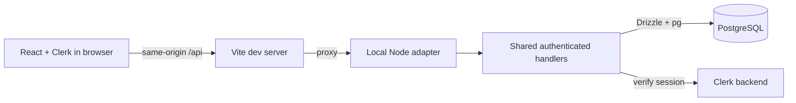

# Chronostasis architecture

Updated: 2026-11-25.

## Scope and deployment status

Chronostasis is a mobile-first focus app. A React client signs in with Clerk and uses a TypeScript sync API backed by PostgreSQL to unlock chests, run focus sessions, claim rewards, and display inventory. The loaded app supports offline play when it has an authenticated identity and a cached snapshot. Hosted Integration migration, recovery, and authenticated persistence were previously verified. Production preparation and authenticated persistence also passed on 2026-11-02. The deployment runbook records hosted evidence. PWA packaging and Capacitor/iOS packaging are future work.

## Workspace

The pnpm monorepo uses TypeScript, React, Vite, Tailwind CSS, Vercel Functions adapters, Neon-compatible PostgreSQL, Drizzle, Clerk, Vitest, Playwright, and Docker Compose.

- `apps/web` contains the Vite React application, Clerk provider and auth routes, protected Focus and Inventory routes, typed API client, and thin Vercel Function entrypoints. `apps/web/server/api.ts` composes the server runtime for those entrypoints.
- `apps/api` is the local Node HTTP adapter. It loads local environment configuration and serves the same shared API handlers as the Vercel adapters.
- `packages/api` owns server configuration, Clerk session verification, shared Web Request/Response handlers, database composition, and the Node/Vercel adapters.
- `packages/contracts` defines browser-safe Zod request and response schemas, inferred types, and the shared reward selector.
- `packages/db` owns the Drizzle schema, migrations, PostgreSQL pool, repository operations, and transactional catalogue seed.
- `tests/e2e` contains signed-out and authenticated Playwright browser tests.
- `scripts` contains the full local verification runner, Git hook tooling, isolated database/Playwright test runners, and the hosted deployment target validator/build runner.

Workspace libraries emit declarations for TypeScript project references. Type-aware ESLint and strict source type checking run across the workspace. `skipLibCheck` is limited to database, API, browser, and tooling projects to work around errors in installed Drizzle/Clerk declarations; contracts and the local runtime retain declaration checking.

## Local runtime and request flow

`docker compose up --build -d --wait` starts the dependency initializer, PostgreSQL, database migration/seed initializer, local API, and Vite frontend in dependency order. The frontend is published to the host on loopback; PostgreSQL is also available on loopback at port 5433 by default, configurable with `POSTGRES_PORT`. The API binds to `0.0.0.0` inside the private Compose network and its port is not published. Optional host-run API development defaults to `127.0.0.1` (`API_HOST`); the Compose service explicitly overrides it. Postgres uses a named volume. Source mounts support frontend/API hot reload, while a container-owned dependency volume and image-owned workspace symlinks keep host dependencies and `.env` out of application containers. E2E runs request ephemeral host ports to avoid collisions with local services.

The browser flow is:

The client sync engine opens an IndexedDB database for the current authenticated Clerk subject. The account gate checks that the loaded Clerk session matches the authenticated user and obtains a token from that specific session for each same-origin sync request. It disposes the engine when the session or user changes. An initial `GET /api/sync` downloads the account and catalogue. A read-only refresh checks both cached versions. Each upload returns a canonical snapshot and ordered outcomes. The browser keeps tokens in memory. A rejected credential locks the saved account across tabs until authenticated sync succeeds. A small account-scoped Web Storage denial journal is independent of the IndexedDB cache, so a failed IndexedDB denial write cannot unlock a replacement offline engine; it contains no token or gameplay state.

The IndexedDB outbox orders operations by auto-increment key. Across tabs, one per-account Web Lock serializes network requests. A separate action lock lets other tabs save local work during an upload and serializes timer changes with snapshot installation. The client atomically installs each snapshot and deletes the matching terminal acknowledgements. Older user revisions leave the cached snapshot intact. Pending operations replay over the canonical balance, unlocks and inventory. A BroadcastChannel signals committed changes to peers, and window focus reloads local state. A sync flight rereads the durable outbox between batches and attempts each queued ID at most once, draining work from a peer that saves and closes without spinning on a retryable early claim.

Before starting an offline timer, the client checks the shared duration policy and requires at least one eligible candidate. The timer stores its session ID, wall-clock start time, duration and eligible reward pool at start. The engine and Focus display use the same persisted wall-clock deadline, so backgrounding, device sleep, component remount and reload count toward elapsed time. Device-clock changes can advance or delay offline readiness, an explicit user-approved tradeoff; reported start/end timestamps remain untrusted provenance. Completing it selects an unverified reward using the shared selector and atomically replaces the timer with a claim in the outbox. Cancelling discards just that timer. A server-started timer keeps its online origin through connection loss. Transport failures retain the original queued operations and early claims wait for another sync opportunity. A confirmed early claim keeps cancellation available. Enqueueing cancellation withdraws queued reward intent for that session atomically, while an already committed in-flight reward remains canonical. Token acquisition and each API request, including body reads, have a 15-second deadline. Timeouts leave cached progress available in offline mode.

The local Node adapter and Vercel Functions entrypoints convert requests to the same Web `Request`/`Response` handlers. Both preserve request method, headers, and raw body bytes, enforce a 64 KiB body limit, and return the same safe JSON error contract. The hosted runner typechecks function entrypoints before the Vite build. Its app-level `tsconfig.json` repeats the shared compiler options because Vercel does not follow TypeScript project references. Hosted invocation has not been verified.

## Authentication and API

Clerk is the only identity provider. The backend verifies session signatures, issuer, expiry, allowed frontend origin, and session status before database access. The verified Clerk subject is the only identity used for persistence; request-body fields do not select a user. Missing or invalid credentials return 401. Established Clerk signing-key retrieval failures return a fixed 503 before any persistence access, including malformed upstream JSON and allowlisted native network failures. The pinned SDK wraps malformed JWT input separately, so malformed and expired credentials remain 401. Verifier outages leave identified users able to use an unlocked local cache offline. Clerk verification failures log only an allowlisted category or a fixed fallback; error messages and objects are never logged. Responses containing user data or errors are not cached. Unexpected failures do not expose tokens, configuration, SQL, or stack traces.

- `GET /api/health` probes the database and returns a safe 200 or 503 response.
- `POST /api/me` authenticates and conflict-safely initializes the persisted application user.
- `GET /api/me` authenticates and reads the persisted application user.
- `GET /api/sync` authenticates, initializes the account if needed, and serves a full snapshot without the Clerk subject. A freshness check sends `revision` and `catalogueVersion` together. The response is unchanged only when both versions match.
- `POST /api/sync` authenticates and accepts one to 100 operations within the adapters' 64 KiB limit. An invalid envelope or unusable operation ID or type returns 400 before processing begins. Each valid operation runs in order in its own transaction. An invalid payload with a usable operation ID and type gets a rejection at its original position. The response includes all outcomes and a full snapshot.

`knownRevision` provides freshness information. Sync operations validate against current server state and use the verified Clerk subject for ownership. An infrastructure failure stops the batch and returns a safe 500. Earlier commits remain durable, and retries use the same domain IDs to recover their outcomes.

The browser receives only the Clerk publishable key. Clerk's secret key is used by the server and E2E runner, never exposed through a Vite variable or frontend image. Locally and in Production, `CLERK_AUTHORIZED_PARTIES` is an explicit allowlist. On Vercel Preview, the API builds the allowlist from the exact deployment and branch origins in `VERCEL_URL` and `VERCEL_BRANCH_URL`; the static variable may be unset in Preview. This allows generated Preview URLs to work without wildcard origins or per-ticket dashboard edits. Vercel system environment variables must be enabled. Use Clerk Development keys for Preview and Production keys for Production. There is no authentication bypass or test-only login endpoint.

## Data model

`0000_bootstrap.sql` creates `users` and `items`; `0001_chest_catalogue.sql` adds `chests` and the normalized `chest_items` eligibility junction. `0004_focus_sessions.sql` adds `focus_sessions`, and `0005_chr15_full_database_schema.sql` completes the application schema with coins, item/chest descriptions and sprite coordinates, weighted chest eligibility, permanent user chest unlocks, and user-owned item copies. `0006_chr24_session_provenance.sql` adds session and inventory provenance. It locks and checks `focus_sessions` before changing the schema and aborts if any row exists. It backfills identifiable session-less Red gem welcome copies as verified account-creation items and stops if other legacy inventory cannot be classified. `0007_chr24_creation_token_rollout.sql` seeds the token before database preparation releases the migration transaction. A database trigger translates the previous CHR-15 welcome insert into the new verified token, so both application versions can initialize accounts during rollout.

`items.rarity` is constrained to common, rare, epic, legendary, and mythic. The browser and server share the rarity rules. Mythic requires at least 3600 planned seconds, and shorter durations exclude it from the rarity roll and fallback pools. The `chest_items.weight` column controls relative selection among eligible items of the selected rarity. Sprite coordinates are zero-based 16×16 cells.

The transactional catalogue seed upserts five items and one `basic-chest`, with three items eligible for the chest. `creation-token` (Token of Creation) is reserved for first-time account initialization. The user row and one verified, session-less token copy are written in the same transaction. A grant failure rolls back the user insert, and repeated or concurrent initialization grants only one copy. Existing users keep their original `red-gem` welcome copies. Both catalogue items sit outside the chest pool. `user_chests` records permanent access to a chest type.

Focus sessions reference a chest and store an origin of `online` (the default) or `offline`, a `running`, `cancelled`, or `completed` status, a planned duration from 15 to 180 minutes in five-minute increments, and start/end timestamps. PostgreSQL permits at most one running online session per user and requires offline sessions to be completed. A referenced chest is protected from deletion. Users cancel abandoned running sessions explicitly.

Each `user_items` row records one copy. Account-creation copies are verified and have no session. Online rewards are verified and offline claims are unverified, and both require a session. The composite foreign key on `(session_id, user_id)` enforces same-user ownership and protects referenced session history. Multiple copies can reference the same session.

`0008_chr22_sync_revision.sql` adds a safe-integer revision to each user, initially zero including the creation grant. The migration and seed set the basic chest price to zero. An explicit purchase unlocks it. Each new purchase, start, cancellation, online reward, or accepted offline claim increments the revision once in the same transaction as its writes. Matching retries and rejected operations preserve the revision. Repeated account initialization reads the existing user.

The sync repository locks the authenticated user before locking their target session. Purchases use the current catalogue price and balance. Online starts require a reward in the chest that is eligible for the planned duration. Online rewards require an unlocked chest, a running online session and sufficient elapsed PostgreSQL server time. The server rechecks the current pool and rejects the claim without changing the session if no eligible rewards remain. Otherwise it selects a reward and atomically completes the session and grants one verified item. New offline claims require current chest access, chest membership and duration eligibility based on the item's catalogue rarity. The server stores client-reported UTC timestamps with up to three fractional digits. These times remain untrusted, including when the device clock changes during a session. The resulting item retains unverified offline provenance. Retries that match the owner and immutable details of a committed claim return its original result.

A repeatable-read, read-only transaction reads the revision, balance, catalogue, unlocks, item copies and sessions together. The separate SHA-256 catalogue version covers ordered public item, chest and eligibility data, including weights and prices. Snapshots expose only the application user ID.

Database pools are bounded. Hosted connections require certificate verification; local Compose connections use the local non-TLS server. Runtime configuration prefers `DATABASE_URL`, then `NEON_DATABASE_URL` or `NEON_POSTGRES_URL`; migrations prefer `MIGRATION_DATABASE_URL`, then an explicit `DATABASE_URL`, then `NEON_DATABASE_URL_UNPOOLED` or `NEON_POSTGRES_URL_NON_POOLING`, and finally the selected runtime URL. These include the variable names supplied by Vercel's Neon integration with the `NEON_` prefix. Compose uses fixed local-only database credentials and destinations so a host environment variable cannot redirect initialization to another database.

## Styling and mobile layout

The web workspace registers the official Tailwind CSS Vite plugin. Components use Tailwind utilities; `apps/web/src/styles.css` imports Tailwind, defines shared `@theme` tokens, and contains document-level base styles. Vite generates styles in development and production builds. The signed-in routes adapt to narrow mobile screens. Focus displays the chest selector, balance, timer, pending actions, and latest reward. Inventory shows owned and provisional item copies with verification and sync labels. Durably queued operations drive provisional balances and items. Rejections remove provisional effects and display the server explanation.

## Verification and isolation

GTS is authoritative for JavaScript and TypeScript formatting and general lint rules. `pnpm format:check` verifies formatting and `pnpm format:fix` applies GTS fixes. The ESLint flat config layers the full GTS config with the workspace's strict type-aware TypeScript rules, React Hooks rules, and browser/server import restrictions. `pnpm lint` is a non-fixing lint check; `pnpm typecheck` remains the separate TypeScript project check.

The staged-file pre-commit hook delegates to GTS through the repository's `.githooks` path; `commit-msg` continues to add or validate the ticket prefix. `pnpm verify:all` is the local, serial gate for GTS formatting, lint, typecheck, unit tests, PostgreSQL integration tests, hook tests, authenticated Playwright E2E, and production build. Jenkins is not configured; a later pipeline can call this same command.

The focused root checks are `pnpm lint`, `pnpm format:check`, `pnpm typecheck`, `pnpm test:unit`, `pnpm test:integration`, `pnpm test:hooks`, `pnpm test:e2e`, and `pnpm build`. `pnpm verify:all` runs the full set including GTS formatting.

- Unit tests cover contracts, server configuration, authentication, request/response behavior, adapter parity, and frontend API/account states.
- Integration tests use a unique Compose project and isolated `chronostasis_test` database volume for real migrations, user upserts, and catalogue constraints. They clean up only their own resources and do not reset development data.
- Hook tests use temporary repositories and exercise pre-commit setup and the ticket-prefix hook without creating test commits in Chronostasis.
- Playwright runs native IndexedDB and cross-tab locking tests as well as signed-out and authenticated gameplay in Chromium at a 390-pixel viewport. The authenticated suite uses a dedicated Clerk development test user and requires the settings named by the E2E preflight. Each invocation creates and removes its own Compose project and database and dependency volumes. The elapsed-time fixture ages only the selected account's test timer in isolated storage. The normal authenticated claim API enforces server elapsed time and chooses the verified reward.
- The verified Task 8 run passed 104 unit tests, 13 PostgreSQL integration tests, 37 hook tests, and four authenticated/setup/signed-out browser tests. Lint, strict type checking, the production build, and Compose configuration validation also passed. Exact per-task outcomes are recorded in the implementation plan.
- The CHR-12 full local gate passed after review fixes on 2026-10-26 with Node 24.20.0 and pnpm 10.34.7: formatting, lint, typecheck, 172 unit tests, 21 Docker PostgreSQL integration tests, 38 hook tests, four authenticated/setup/signed-out browser tests, and production build. These local results do not establish hosted acceptance.

## Hosting boundary

The [deployment runbook](docs/DEPLOYMENT.md) records owner setup, release/recovery steps, dashboard observations, and verified hosted runtime evidence. Vercel redirects `chronostasis.tech` to the canonical application origin `https://www.chronostasis.tech`; Clerk Production uses `https://clerk.chronostasis.tech`. Ticket and integration-branch Previews share Neon Integration and Clerk Development.

The hosted topology is a static Vite build and Vercel Functions connected to Neon PostgreSQL. `apps/web/api` contains the Vercel adapters and routing configuration. `scripts/deploy-build.mjs` validates the Vercel environment, branch, Neon URL pair, and configured direct-host marker before running the function typecheck and app build. Production deployments prepare the persistent Production branch. A Vercel ignored-build rule skips automatic deployments of the `integration` branch; an owner can explicitly redeploy its selected commit to prepare the persistent Integration branch. Other Preview builds share Integration and skip preparation. A direct PostgreSQL connection and session advisory lock serialize migrations and catalogue seeding. Local builds and Docker Compose remain separate from this hosted runner. Integration preparation was exercised successfully at commit `6bf3379`; hosted signed-in persistence passed on Preview `BksEByGDoXAni1fWdNCfpniMFxDg` at commit `242f474` after the owner corrected the Preview Clerk secret. The account remained ready after reload. Hosted acceptance later verified migration-only triggering, additive application and retry, failure isolation, and forward cleanup at `9186ea7`. Integration now has four journal entries and no probe; its two users and catalogue counts 3/1/3 were preserved. Production was uninitialized before release; its approved main build now has the same four migrations and catalogue, with one independently initialized Production user. Actual collaborator acceptance was waived by the owner. Production preparation/retry, catalogue, and authenticated persistence passed at source `631d636` after the owner corrected the Production Clerk secret. A future PWA or Capacitor shell can reuse the React client and HTTPS API, with its own platform/auth callback work.
