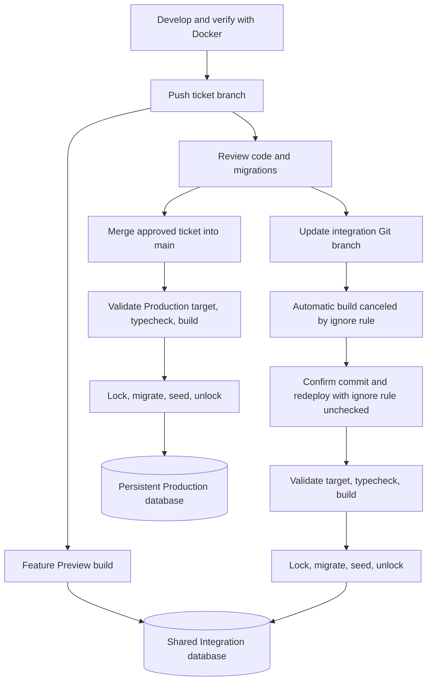

# Vercel and Neon deployment

The repository implements this workflow. Dashboard setup was inspected and updated on 2026-10-26: persistent Neon targets, database hostname guards, separate Clerk environment entries, and Clerk DNS/certificates are configured. Vercel redirects `chronostasis.tech` to the canonical application origin `https://www.chronostasis.tech`. The CHR-12 Preview target guard, Integration preparation, and signed-in account persistence after reload have been exercised successfully. Production runtime acceptance and the remaining migration experiments are pending.

## Environment flow

| Application deployment | Database | Preparation |
| --- | --- | --- |
| Local development | Docker PostgreSQL | Compose startup |
| Feature/bugfix/maintenance Preview | Persistent Neon Integration | Never during the Preview build |
| Explicit `integration` branch redeploy | Persistent Neon Integration | Pending migrations, then catalogue seed |
| `main` Production deployment | Persistent Neon Production | Pending migrations, then catalogue seed |

Integration and Production are separate Neon branches. Application code and committed migrations move through Git; Integration data is never merged into Production. The catalogue seed supplies reference data only, with no demo users. Ordinary `pnpm build` and `pnpm verify:all` do not invoke hosted preparation.

## One-time owner setup

### Neon connections

1. Keep the existing Production branch. Create or select one persistent Integration branch with a read-write compute and no expiration. Choose sanitized or schema-only starting data where available; a normal child branch inherits its parent's data. Do not copy personal Production data into a shared testing environment without an appropriate sanitization process.
2. Set Integration as the Neon project's default branch. In Neon → Integrations → Vercel settings, explicitly select Production as the **Production branch**. The Production selection is independent of the default branch.
3. In Vercel's Neon project connection, enable **Production only**, keep prefix `NEON`, and leave automatic database branching unchecked. Configure Preview explicitly with Secret variables `NEON_DATABASE_URL` (pooled) and `NEON_DATABASE_URL_UNPOOLED` (direct) from the persistent Neon `integration` branch. The owner enters and saves these credentials in Vercel; do not store them in repository files. This project uses persistent databases instead of automatic database creation for every deployment.
4. Verify a new Preview receives Integration credentials and a new Production deployment receives Production credentials. Inspect the actual deployment configuration; project-level entries alone do not prove which credentials a deployment uses.
5. Record each branch ID, its direct endpoint hostname, region, and access owner in the evidence table below. Check compute/branch limits and region placement before rollout.

Neon's [integration documentation](https://neon.com/docs/guides/vercel-managed-integration) describes the branch selectors and optional automatic branching. Changing settings does not retarget existing deployments; use new deployments and confirm their targets.

The first CHR-12 Preview failed the Integration hostname guard with the managed connection enabled for Preview. The saved Integration guard was subsequently confirmed correct. Changing the Neon default branch did not establish the required Preview target. With owner approval, the managed connection was changed to Production only, and a Preview-only Secret form was prepared for the explicit Integration pair. The owner saved both Preview-only Secret URLs; their presence and scopes were confirmed. The retry reached Ready and passed hostname validation; the browser health endpoint returned `{"status":"ok"}` with `cache-control: no-store`; authenticated persistence subsequently passed after correcting the Preview Clerk secret. Keep the hostname guard unchanged; the endpoint injected into the failed deployment was not exposed.

### Vercel project and variables

Confirm the connected repository is `den1kon/chronostasis`, Production tracks `main`, and Root Directory is `apps/web`. Enable access to workspace files outside that directory. Keep skipping unaffected projects enabled, subject to the migration-only deployment check below. If that check fails, investigate dependency detection and disable skipping as a fallback. Use Node 24, pnpm `10.34.7`, and a frozen-lockfile install. Keep system environment variables exposed, including `VERCEL`, `VERCEL_ENV`, `VERCEL_GIT_COMMIT_REF`, `VERCEL_URL`, and `VERCEL_BRANCH_URL`.

Let committed `apps/web/vercel.json` supply the build and ignore commands; remove conflicting dashboard overrides. Its commands resolve the repository scripts from `apps/web`. The hosted build checks function entrypoints before the regular app build, then prepares the selected database only when permitted.

Configure these variables in **both Preview and Production**:

| Variable | Value/source |
| --- | --- |
| `NEON_POSTGRES_URL` + `NEON_POSTGRES_URL_NON_POOLING` | Neon integration's complete pooled runtime/direct migration pair for that environment |
| Alternative: `NEON_DATABASE_URL` + `NEON_DATABASE_URL_UNPOOLED` | Accepted complete alias pair; if both pairs exist, they must identify the same destination |
| `DEPLOYMENT_INTEGRATION_DB_HOST` | Integration's direct endpoint hostname from Neon Connect, with pooling disabled; hostname only |
| `DEPLOYMENT_PRODUCTION_DB_HOST` | Production's direct endpoint hostname from Neon Connect, with pooling disabled; hostname only |

The two host markers have the same values across Preview and Production. They are non-secret guards against accidental target swaps. Copy only the hostname, without scheme, credentials, port, path, or query. Update the corresponding marker if its endpoint changes, then redeploy. Remove hosted `DATABASE_URL`, `MIGRATION_DATABASE_URL`, and `PGPORT` values; the runner rejects them to prevent stale overrides. In particular, `pg` inherits `PGPORT` when a URL omits its port. Keep database credentials protected in Vercel and out of contributor `.env` files.

The runner checks that each runtime/direct pair resolves to the same endpoint, port, and database name, and that the migration connection is direct. Every Preview must match Integration's marker; Production must match Production's marker. These checks catch configuration mistakes; contributors whose code executes with Preview secrets must still be trusted.

The persistent `integration` Git branch was created and pushed at `8436c71eb92bc8680daa89d2231189aa6af6fb16` on 2026-10-26. Keep it available. A push to it creates an automatically canceled Preview build through `ignoreCommand`. Its selected commit can then be redeployed explicitly. Vercel documents the [Ignored Build Step redeploy bypass](https://vercel.com/docs/project-configuration/project-settings#ignore-build-step-on-redeploy). Confirm the actual dashboard sequence during hosted acceptance.

### Clerk and the Production domain

For Local and Preview, use a matching Clerk development publishable key, secret key, and issuer. Give contributors the necessary development settings and a dedicated development E2E account. Production uses the matching triplet from the Clerk Production instance. Configure `VITE_CLERK_PUBLISHABLE_KEY`, `CLERK_SECRET_KEY`, and `CLERK_ISSUER` in their respective Vercel environments. Copy the issuer exactly from that instance; it may be an authentication subdomain and must not be guessed from the application URL.

In Clerk Production, configure the application domain `chronostasis.tech`, add the requested DNS records, and complete domain/certificate verification. Check production OAuth credentials and redirects for enabled providers. Vercel's domain attachment does not complete these Clerk steps. Follow Clerk's [Production deployment guide](https://clerk.com/docs/guides/development/deployment/production).

Set Production `CLERK_AUTHORIZED_PARTIES` to `https://www.chronostasis.tech`, matching the existing bare-domain redirect; add other exact origins only if those aliases are intentionally supported. Use comma-separated origins without paths or wildcards. Leave this variable unset in Preview: the API derives exact allowed origins from `VERCEL_URL` and `VERCEL_BRANCH_URL`. Local development keeps its explicit localhost origin. Development and Production identities are separate; signing in to Clerk does not itself create an application database row.

Vercel Preview includes both ticket branches and the Git `integration` branch. Both use Neon `integration` and Clerk Development; Production uses Git `main`, Neon `main`, and Clerk Production. Clerk has no separate instance named Integration. Publishable keys are public Config values in Vercel; secret keys remain Secret values. The configured issuers are `https://elegant-aardvark-1949.clerk.accounts.dev` for Preview and `https://clerk.chronostasis.tech` for Production. The owner entered the Preview secret; only its presence and scope were verified. The Production secret still requires owner verification, followed by authenticated deployment checks for both environments.

The default `.vercel.app` Preview suffix is sufficient. Vercel's Preview Deployment Suffix setting is separate from attaching `chronostasis.tech` to Production; this workflow does not require a custom Preview suffix.

### Contributor deployment access

Git access and Vercel deployment eligibility are separate. Vercel's private-repository author restrictions for organizations/groups do not apply to collaborators on personal Git accounts. Where those restrictions apply, Pro/Enterprise deployments require eligible team membership and a linked Git identity; Hobby has owner-author restrictions. Public fork deployments can require owner/team approval. Check the current [Vercel Git rules](https://vercel.com/docs/git) and test an actual contributor push before deciding whether account changes are needed.

Allow reviewers to open Preview URLs under the chosen Deployment Protection policy. Approve fork deployments only after reviewing their code, since that code may receive Preview secrets. Merging later triggers Production; it does not supply the pre-merge Preview required for review.

## Daily contributor and release flow

1. Work on a ticket branch using Docker. For a schema change, generate and review the Drizzle migration with the schema change, then run the local gate described in [DEVELOPMENT.md](DEVELOPMENT.md). Commit only after the required unstaged review.
2. Push through the normal reviewed contribution process. The feature Preview builds against shared Integration configuration and does not migrate or seed. If the code requires a new schema, its database-dependent behavior may remain unavailable until Integration preparation is approved and completed.
3. Coordinate schema changes with the owner. Keep one consistent migration history across ticket branches, Integration, and `main`. Test risky migrations on a disposable Neon branch before touching shared Integration. Keep old Preview and Production code compatible with additive changes.
4. After review, update the `integration` Git branch to contain the selected changes. In Vercel Deployments, find the latest entry for **branch `integration`**, including the canceled build, and confirm its commit SHA. Do not select an older successful deployment merely because it is ready.
5. Choose **Redeploy**, retain the Preview environment/Integration branch configuration, and uncheck **Use project's Ignore Build Step**. Confirm the SHA again. The build validates configuration, typechecks, builds, then prepares Integration. If the expected commit entry or bypass is unavailable, stop and resolve dashboard configuration before running a different deployment.
6. Verify the shared schema/catalogue and the feature Preview's authenticated behavior. Repeat preparation if needed; migrations use their journal and catalogue upserts remain repeatable. Existing users and additional catalogue definitions are preserved.
7. Merge the approved ticket into `main` through the normal release process. A fresh Production deployment validates and prepares Production independently. Verify health and account persistence on `https://www.chronostasis.tech` and the bare-domain redirect. Do not promote a Preview artifact carrying Preview database/auth configuration into Production.

Database preparation waits up to 60 seconds for a session advisory lock on one direct connection, then migrates and seeds. The lock serializes preparation jobs, not application publication. Old code can serve traffic during a migration; destructive schema changes require an expand/contract sequence across releases. Never edit an applied migration, reset a hosted database, or run independent migration commands alongside deployment preparation. Recover with a reviewed forward migration. An application rollback does not undo database changes, and packaging can fail after preparation has already succeeded. Redeploying old seed code can restore old catalogue names; put removals and one-time transformations in versioned migrations.

## Diagnostics and recovery

| Symptom/stage | Check and action |
| --- | --- |
| `Deployment configuration failed` | Check Vercel/system metadata, complete Neon pairs, both direct-host markers, and stale unprefixed overrides. Configuration fails before child processes start. Never paste URL values into logs or tickets. |
| `web function typecheck` or `application build` failed | Fix the named application check; preparation has not run. Reproduce with local typecheck/build. |
| `Database connection failed` | Check the deployment's environment target, direct endpoint availability, credentials, and TLS configuration in the service dashboards. Keep certificate verification enabled. |
| `Database preparation lock failed` | Another preparation may still be running or the wait expired. Inspect active deployment jobs, let the owner job finish, then retry. Avoid independent migration commands. |
| `Database migration failed` | Inspect the committed migration and journal using the intended branch. Determine what applied before retrying; use a reviewed corrective migration when needed. |
| `Database seed failed` | Check catalogue constraints and current migration state. The seed owns its transaction; fix the cause and retry. No reset is required. |
| API health returns 503 | Confirm runtime credentials point to the same intended branch and the schema exists there. Review protected platform logs without exposing secrets. |
| Authentication returns 401 | Verify the Clerk instance triplet and exact allowed frontend origin. Direct browser navigation to `/api/me` has no frontend bearer header and is expected to return 401; inspect the signed-in UI's authenticated request instead. |
| A branch appears to contain unexpected users/data | Confirm its Neon branch ID and parent history. Normal Neon branching inherits parent data; an apparently new branch is not necessarily empty. |
| Database inspected in Neon disagrees with the app | Match the deployment's direct endpoint hostname to the Neon branch/compute in the dashboard. A database name alone does not identify a Neon branch. |

For safe identity inspection, record only the deployment ID/SHA, environment, direct hostname, and Neon branch ID. In that branch's SQL editor, `select current_database(), current_user;` can confirm database/role but cannot prove the branch by itself. Inspect the migration journal and required catalogue rows there. Never record passwords, connection strings, tokens, or environment dumps.

Review Vercel deployment retention separately from database lifecycle. Integration and Production persist across Preview cleanup. Once automatic database branching is disabled, verify and remove only obsolete temporary branches that are no longer referenced; preserve both persistent environment branches and any active migration experiment. Restrict Integration resets to a separately reviewed owner operation with explicit data-loss approval.

## Acceptance record

### Status recheck — 2026-11-02

- Remote heads confirmed: `maintenance/CHR-12` → `242f474`, `integration` → `6bf3379`, `main` → `6ae1f7d`. CHR-12 has not been released through `main`.
- Frozen install and `pnpm verify:all` passed using Node 24.20.0 and pnpm 10.34.7: formatting, lint, typecheck, 174 unit tests, 21 PostgreSQL integration tests, 38 hook tests, four Playwright tests including real Clerk Development sign-in and local account persistence, and production build. The host default is now Node 24.21.0; verification selected the exact required version through npm exec without changing repository configuration.
- Production `GET /api/health` returned HTTP 200 with `{"status":"ok"}`. The bare domain returned HTTP 308 to `https://www.chronostasis.tech/`. This checks the existing Production deployment, not a CHR-12 release.
- The ticket Preview initially redirected the browser to `/sign-in?returnTo=%2F`. After the owner signed in, computer-use inspection confirmed `Account ready` on the CHR-12 branch alias before and after a browser reload on 2026-11-02. Hosted initialize/read persistence acceptance therefore passed again. Unauthenticated CLI access remains protected by Vercel SSO.
- Four rollout documentation files remain unstaged. Migration-only deployment triggering, hosted additive-migration/retry/failure-isolation experiments, collaborator acceptance, Production release/authentication, and explicit ticket-completion approval remain outstanding.

### Migration probe baseline — 2026-11-02

Owner screenshot confirms Root Directory `apps/web`, outside-root build files enabled, and unaffected-project deployment skipping enabled. The documentation-only parent `4043738` deployed successfully as `QFrb42aE75tvnzJ9pqfZz2wAFBcP` before the migration-only push.

Owner-provided Integration query result: database `neondb`; probe absent; migration count 2; migration digest `706bc4073091fce05d601e1ea04cce2a`; users 2; items 3; chests 1; chest-item relationships 3. Production query returned SQLSTATE 42P01 for absent `drizzle.__drizzle_migrations`; a subsequent owner-provided safe catalog query confirmed `public.users`, `public.items`, `public.chests`, `public.chest_items`, `public.chr12_deployment_probe`, and the Drizzle journal are all absent. This establishes the checked application schema is uninitialized; it does not establish that the entire database has no other data.

### Earlier rollout evidence

Local verification passed after review fixes on 2026-10-26 following a frozen-lockfile install with Node 24.20.0 and pnpm 10.34.7. `pnpm verify:all` passed formatting, lint, typecheck, 172 unit tests, 21 Docker database integration tests, 38 hook tests, four authenticated/setup/signed-out Playwright tests, and the production build. The session diagnostic committed as `242f474` was subsequently verified with the same full gate and 174 unit tests; all stages passed. The sandboxed attempt could not bind a local test socket; the escalated rerun passed.

Dashboard observations below were recorded on 2026-10-26. They do not prove successful deployment or runtime configuration. Deployment acceptance remains pending; record real deployment observations without credentials.

| Evidence | Status / identifiers |
| --- | --- |
| Vercel root/build/system variables and branch settings | Observed: `apps/web`, outside-root files enabled, Vite, `dist`, Node 24.x, system variables enabled, Production tracks `main`, Preview tracks other branches. Build/install overrides off; frozen install and committed build/ignore commands still need deployment-log confirmation. Unaffected-project skipping remains enabled pending the migration-only check. |
| Neon Integration branch ID/direct hostname/default selection | Observed default `integration`: `br-divine-waterfall-b9e8ngi1`; `ep-broad-feather-b9k7ebxk.c-7.eu-central-1.aws.neon.tech`; AWS Frankfurt. Owner: Denys Kondratiuk. |
| Neon Production branch ID/direct hostname/Production selection | Observed explicit Production selection `main`: `br-plain-sound-b9u11l17`; `ep-divine-night-b9x3wt2m.c-7.eu-central-1.aws.neon.tech`; AWS Frankfurt. Owner: Denys Kondratiuk. |
| Automatic database branches disabled; both target markers verified | Automatic branching off, prefix `NEON`; managed connection changed to Production only after failed Preview targeting. Both markers saved as Config in both environments; Integration marker value rechecked against Neon after the failure. Owner saved the explicit Preview URL pair; both Secret entries and Preview-only scopes confirmed. Preview retry passed the Integration hostname guard; Production target and authenticated runtime queries remain pending. |
| Clerk Production domain/DNS, matching keys/issuer, exact origins | All five DNS records Verified; Frontend API and Account portal certificates Issued. Separate public keys/issuers saved for Preview and Production; Production origin saved as `https://www.chronostasis.tech`. Preview secret present and scoped only to Preview after owner entry. Production secret present, owner verification pending. Secret validity, OAuth setup, and authenticated runtime checks remain pending. |
| Owner ticket Preview: deployment ID/SHA; no preparation; Integration target | Ready: `AMFWvzgekiyDShKQL7MsFAjT4kQg`, commit `8436c71eb92bc8680daa89d2231189aa6af6fb16`; `https://chronostasis-6k5nx22dv-denikon.vercel.app`. Hostname validation passed; logs show function typecheck and application build, no database preparation stage. Signed-out browser loaded Clerk sign-in in Development mode; `/api/health` returned `{"status":"ok"}` with `cache-control: no-store`. Actual collaborator deployment and authenticated persistence remain pending. |
| First owner CHR-12 Preview attempt | Failed: `DTynKq74EbuF3cp9eHdE4QW97SoU`, commit `8436c71eb92bc8680daa89d2231189aa6af6fb16`, branch `maintenance/CHR-12`. Log: `Configured Neon database does not match the integration target marker.` Validation stopped before typecheck, application build, or database preparation. Build/ignore scripts were invoked and pnpm 10.34.7 detected; actual injected endpoint and correction remain pending. |
| Migration-only commit with unaffected-project skipping enabled: automatic feature Preview created; deployment ID/SHA and changed migration path; no preparation or database changes | Owner screenshot confirms skipping enabled. Documentation parent `4043738` deployed first. Commit `a42e563` changes only `packages/db/drizzle/0002_chr12_preview_probe.sql`, its snapshot, and journal. Push automatically created Preview `GzzYFFfrhoxkcfKhtv77jcK8C653`; GitHub Vercel status succeeded; owner-supplied logs confirm commit `a42e563`, web function typecheck and application build only, no database-preparation stage, and completed deployment. Integration post-build baseline is unchanged: probe absent, migrations 2, digest `706bc4073091fce05d601e1ea04cce2a`, users 2, items 3, chests 1, relationships 3. Production catalog query confirms all six checked relations (migration journal, users, items, chests, chest_items, probe) absent. Migration-only triggering and non-migrating Preview behavior passed. |
| Integration canceled build → explicit redeploy: selected SHA/deployment ID; preparation log | Commit `6bf3379cd44c0b621b0ccd31340e0d64da434617`: automatic entry `CAYm2Q3cBXXdLAfpEATpWqR7j7da` canceled as intended. Explicit Preview redeploy `3fFGN8z1V85GDAK6bPgGAEYWFRyK` reached Ready in 35 seconds. Logs show Integration function typecheck, application build, database preparation through `corepack pnpm`, and `Database preparation complete.` Branch alias: `https://chronostasis-git-integration-denikon.vercel.app`. A separate migration experiment and retry remain pending. |
| First explicit Integration preparation attempt | Canceled entry `DM5DYsnMdYxdP5XBJ1zwjCNnyr6R` at `8436c71`; explicit Preview redeploy `AW5wh8RqGQxEozvHsQgoLDne3GLG` with ignore step unchecked. Target validation, typecheck, and app build succeeded. Preparation failed before migration execution: nested pnpm 10.28.0 violated required 10.34.7. Root `db:prepare` Corepack fix was committed as `6bf3379`, pushed to the ticket and Integration branches, and verified by the successful redeploy above. |
| Disposable additive migration/catalogue change applied to Integration only; retry stable | Owner reports explicit application of reviewed `a42e563`: probe present and empty (0 rows), migration count 3, migration digest `0cb4b0803d797585cf79ff62ae21afe2`, users 2, items 3, chests 1, chest-item relationships 3. Owner subsequently repeated the explicit Integration deployment: the complete baseline and empty probe count remained identical. Post-retry Production catalog query again returned null for all six checked relations. Additive application, retry stability, catalogue/user count preservation, and Production schema isolation passed. Successful explicit deployment URLs/preparation log excerpts have not yet been supplied. |
| Health and authenticated UI `POST`/`GET /api/me`; user row in exact Integration branch | Health returned `{"status":"ok"}`. After owner sign-up, CHR-12 branch alias showed `Your session needs to be refreshed. Please sign in again.` before and after reload. This initial authentication failure was subsequently diagnosed and resolved as recorded below. A direct SQL inspection of the user row has not been performed. Subsequent browser inspection confirmed `POST /api/me` returns 401 with a bearer header; visible claims have the expected Development issuer, branch-alias origin, active session, subject/session identifiers, and expiry after the request. Saved Preview issuer matches. Diagnostic commit `242f474` was owner-reviewed, committed, pushed, and deployed as Preview `2eZo9fStBAyMrEPZkW5KpmbrWkTT` (Ready). The reproduced request logged `Clerk session rejected secret-key-invalid`. The owner replaced the Preview-only `CLERK_SECRET_KEY` using the Development instance key and saved it. Redeploy `BksEByGDoXAni1fWdNCfpniMFxDg` at `242f474` reached Ready; `https://chronostasis-git-maintenance-chr-12-denikon.vercel.app` displayed `Account ready`, including after a browser reload. The UI reaches this state only after authenticated initialize/read requests return matching user identities. Credential entry/save was performed by the owner. Logs contain only allowlisted categories, excluding raw errors, messages, tokens, keys, and user details. |
| Approved `main` release: deployment ID/SHA; Production migration/catalogue and existing users preserved | Pending |
| Production health and authenticated account persistence on `www.chronostasis.tech`; bare-domain redirect | Pending |
| Failed Integration preparation on a disposable change fails deployment; Production unchanged | Custom `0003_chr12_failure_probe` is prepared locally and deliberately raises a fixed exception. A disposable local Docker test applied the first three migrations, then confirmed the fourth causes `db:prepare` to exit nonzero with `Database migration failed.`, preserves the migration count/digest and all observed row counts, and releases the advisory lock. Local formatting/lint/typecheck, 174 unit tests, 38 hook tests, and application build passed. The normal database-integration/E2E suites were not rerun for this deliberately broken intermediate fixture, which intentionally fails database preparation; rerun the complete gate after recovery. Hosted failure deployment, Production isolation recheck, and recovery remain pending. |
| Full local gate | Passed again for `6bf3379` on 2026-10-26 after a frozen-lockfile install; results above. Independent bug/security follow-up reviews of `8436c71..6bf3379` found no actionable findings. |
| Permitted bug and security reviews, findings resolved, completion approval | Independent agent reviews and follow-ups completed; three findings fixed. Dedicated Bugbot/Security Review agent types were unavailable. Completion approval pending. |

For the migration experiment, first confirm its feature Preview leaves both databases unchanged. Then explicitly prepare Integration, verify the change there and no Production change, and repeat preparation to check stability. Release that reviewed migration through `main` only with authorization. Remove test-only objects through a reviewed follow-up migration when appropriate. Hosted writes, merges, PR creation, and ticket completion each follow the repository's approval rules.

### Deliberate failure fixture (temporary acceptance step)

`0003_chr12_failure_probe` performs no application DML/DDL: its `DO` block raises a fixed exception to test the migration failure boundary. It must not be released through `main`. After the reviewed ticket Preview proves it does not migrate, explicitly deploy the reviewed Integration commit and expect preparation failure. The previously Ready Integration deployment should remain active; verify its URL, the unchanged three-entry migration journal/digest, empty probe table, and original catalogue/user counts. Recheck Production's six catalog lookups remain null. Remove the never-applied failing SQL/snapshot/journal entry in a new reviewed recovery commit; retain all applied migrations. Then add a forward migration removing the empty disposable probe table and rerun the full acceptance gate before release.
