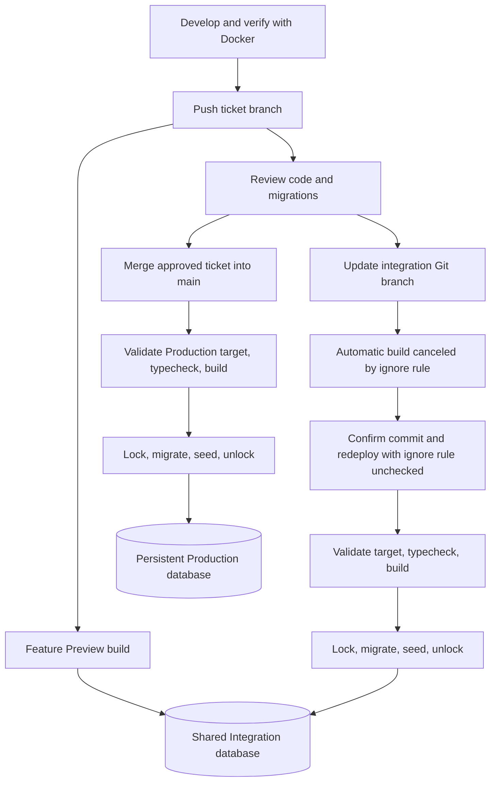

# Vercel and Neon deployment

The repository implements this workflow; dashboard configuration and hosted acceptance are still pending. `chronostasis.tech` is already attached to Vercel Production according to the owner. Clerk domain setup and authenticated hosted persistence have not been verified.

## Environment flow

| Application deployment | Database | Preparation |
| --- | --- | --- |
| Local development | Docker PostgreSQL | Compose startup |
| Feature/bugfix/maintenance Preview | Persistent Neon Integration | Never during the Preview build |
| Explicit `integration` branch redeploy | Persistent Neon Integration | Pending migrations, then catalogue seed |
| `main` Production deployment | Persistent Neon Production | Pending migrations, then catalogue seed |

Integration and Production are separate Neon branches. Application code and committed migrations move through Git; Integration data is never merged into Production. The catalogue seed supplies reference data only, with no demo users. Ordinary `pnpm build` and `pnpm verify:all` do not invoke hosted preparation.

## One-time owner setup

### Neon connections

1. Keep the existing Production branch. Create or select one persistent Integration branch with a read-write compute and no expiration. Choose sanitized or schema-only starting data where available; a normal child branch inherits its parent's data. Do not copy personal Production data into a shared testing environment without an appropriate sanitization process.
2. Set Integration as the Neon project's default branch. In Neon → Integrations → Vercel settings, explicitly select Production as the **Production branch**. The Production selection is independent of the default branch.
3. In Vercel's Neon project connection, enable Preview and Production environments, keep prefix `NEON`, and leave both Preview and Production unchecked under **Create database branch for deployment**. This project uses persistent databases instead of automatic database creation for every deployment.
4. Verify a new Preview receives Integration credentials and a new Production deployment receives Production credentials. Inspect the actual deployment configuration; project-level entries alone do not prove which credentials a deployment uses.
5. Record each branch ID, its direct endpoint hostname, region, and access owner in the evidence table below. Check compute/branch limits and region placement before rollout.

Neon's [integration documentation](https://neon.com/docs/guides/vercel-managed-integration) describes the branch selectors and optional automatic branching. Changing settings does not retarget existing deployments; use new deployments and confirm their targets.

### Vercel project and variables

Confirm the connected repository is `den1kon/chronostasis`, Production tracks `main`, and Root Directory is `apps/web`. Enable access to workspace files outside that directory. Disable skipping unaffected projects for this project so migration and shared-package commits reach the runner. Use Node 24, pnpm `10.34.7`, and a frozen-lockfile install. Keep system environment variables exposed, including `VERCEL`, `VERCEL_ENV`, `VERCEL_GIT_COMMIT_REF`, `VERCEL_URL`, and `VERCEL_BRANCH_URL`.

Let committed `apps/web/vercel.json` supply the build and ignore commands; remove conflicting dashboard overrides. Its commands resolve the repository scripts from `apps/web`. The hosted build checks function entrypoints before the regular app build, then prepares the selected database only when permitted.

Configure these variables in **both Preview and Production**:

| Variable | Value/source |
| --- | --- |
| `NEON_POSTGRES_URL` + `NEON_POSTGRES_URL_NON_POOLING` | Neon integration's complete pooled runtime/direct migration pair for that environment |
| Alternative: `NEON_DATABASE_URL` + `NEON_DATABASE_URL_UNPOOLED` | Accepted complete alias pair; if both pairs exist, they must identify the same destination |
| `DEPLOYMENT_INTEGRATION_DB_HOST` | Integration's direct endpoint hostname from Neon Connect, with pooling disabled; hostname only |
| `DEPLOYMENT_PRODUCTION_DB_HOST` | Production's direct endpoint hostname from Neon Connect, with pooling disabled; hostname only |

The two host markers have the same values across Preview and Production. They are non-secret guards against accidental target swaps. Copy only the hostname, without scheme, credentials, port, path, or query. Update the corresponding marker if its endpoint changes, then redeploy. Remove hosted `DATABASE_URL`, `MIGRATION_DATABASE_URL`, and `PGPORT` values; the runner rejects them to prevent stale overrides. In particular, `pg` inherits `PGPORT` when a URL omits its port. Keep database credentials protected in Vercel and out of contributor `.env` files.

The runner checks that each runtime/direct pair resolves to the same endpoint, port, and database name, and that the migration connection is direct. Every Preview must match Integration's marker; Production must match Production's marker. These checks catch configuration mistakes; contributors whose code executes with Preview secrets must still be trusted.

Keep the persistent `integration` Git branch available. A push to it creates an automatically canceled Preview build through `ignoreCommand`. Its selected commit can then be redeployed explicitly. Vercel documents the [Ignored Build Step redeploy bypass](https://vercel.com/docs/project-configuration/project-settings#ignore-build-step-on-redeploy). Confirm the actual dashboard sequence during hosted acceptance.

### Clerk and the Production domain

For Local and Preview, use a matching Clerk development publishable key, secret key, and issuer. Give contributors the necessary development settings and a dedicated development E2E account. Production uses the matching triplet from the Clerk Production instance. Configure `VITE_CLERK_PUBLISHABLE_KEY`, `CLERK_SECRET_KEY`, and `CLERK_ISSUER` in their respective Vercel environments. Copy the issuer exactly from that instance; it may be an authentication subdomain and must not be guessed from the application URL.

In Clerk Production, configure the application domain `chronostasis.tech`, add the requested DNS records, and complete domain/certificate verification. Check production OAuth credentials and redirects for enabled providers. Vercel's domain attachment does not complete these Clerk steps. Follow Clerk's [Production deployment guide](https://clerk.com/docs/guides/development/deployment/production).

Set Production `CLERK_AUTHORIZED_PARTIES` to `https://chronostasis.tech`; add other exact origins only if those aliases are intentionally supported. Use comma-separated origins without paths or wildcards. Leave this variable unset in Preview: the API derives exact allowed origins from `VERCEL_URL` and `VERCEL_BRANCH_URL`. Local development keeps its explicit localhost origin. Development and Production identities are separate; signing in to Clerk does not itself create an application database row.

The default `.vercel.app` Preview suffix is sufficient. Vercel's Preview Deployment Suffix setting is separate from attaching `chronostasis.tech` to Production; this workflow does not require a custom Preview suffix.

### Contributor deployment access

Git access and Vercel deployment eligibility are separate. Vercel's private-repository author restrictions for organizations/groups do not apply to collaborators on personal Git accounts. Where those restrictions apply, Pro/Enterprise deployments require eligible team membership and a linked Git identity; Hobby has owner-author restrictions. Public fork deployments can require owner/team approval. Check the current [Vercel Git rules](https://vercel.com/docs/git) and test an actual contributor push before deciding whether account changes are needed.

Allow reviewers to open Preview URLs under the chosen Deployment Protection policy. Approve fork deployments only after reviewing their code, since that code may receive Preview secrets. Merging later triggers Production; it does not supply the pre-merge Preview required for review.

## Daily contributor and release flow

1. Work on a ticket branch using Docker. For a schema change, generate and review the Drizzle migration with the schema change, then run the local gate described in [DEVELOPMENT.md](DEVELOPMENT.md). Commit only after the required unstaged review.
2. Push through the normal reviewed contribution process. The feature Preview builds against shared Integration configuration and does not migrate or seed. If the code requires a new schema, its database-dependent behavior may remain unavailable until Integration preparation is approved and completed.
3. Coordinate schema changes with the owner. Keep one consistent migration history across ticket branches, Integration, and `main`. Test risky migrations on a disposable Neon branch before touching shared Integration. Keep old Preview and Production code compatible with additive changes.
4. After review, update the `integration` Git branch to contain the selected changes. In Vercel Deployments, find the latest entry for **branch `integration`**, including the canceled build, and confirm its commit SHA. Do not select an older successful deployment merely because it is ready.
5. Choose **Redeploy**, retain the Preview environment/Integration branch configuration, and uncheck **Use project's Ignore Build Step**. Confirm the SHA again. The build validates configuration, typechecks, builds, then prepares Integration. If the expected commit entry or bypass is unavailable, stop and resolve dashboard configuration before running a different deployment.
6. Verify the shared schema/catalogue and the feature Preview's authenticated behavior. Repeat preparation if needed; migrations use their journal and catalogue upserts remain repeatable. Existing users and additional catalogue definitions are preserved.
7. Merge the approved ticket into `main` through the normal release process. A fresh Production deployment validates and prepares Production independently. Verify health and account persistence on `chronostasis.tech`. Do not promote a Preview artifact carrying Preview database/auth configuration into Production.

Database preparation waits up to 60 seconds for a session advisory lock on one direct connection, then migrates and seeds. The lock serializes preparation jobs, not application publication. Old code can serve traffic during a migration; destructive schema changes require an expand/contract sequence across releases. Never edit an applied migration, reset a hosted database, or run independent migration commands alongside deployment preparation. Recover with a reviewed forward migration. An application rollback does not undo database changes, and packaging can fail after preparation has already succeeded. Redeploying old seed code can restore old catalogue names; put removals and one-time transformations in versioned migrations.

## Diagnostics and recovery

| Symptom/stage | Check and action |
| --- | --- |
| `Deployment configuration failed` | Check Vercel/system metadata, complete Neon pairs, both direct-host markers, and stale unprefixed overrides. Configuration fails before child processes start. Never paste URL values into logs or tickets. |
| `web function typecheck` or `application build` failed | Fix the named application check; preparation has not run. Reproduce with local typecheck/build. |
| `Database connection failed` | Check the deployment's environment target, direct endpoint availability, credentials, and TLS configuration in the service dashboards. Keep certificate verification enabled. |
| `Database preparation lock failed` | Another preparation may still be running or the wait expired. Inspect active deployment jobs, let the owner job finish, then retry. Avoid independent migration commands. |
| `Database migration failed` | Inspect the committed migration and journal using the intended branch. Determine what applied before retrying; use a reviewed corrective migration when needed. |
| `Database seed failed` | Check catalogue constraints and current migration state. The seed owns its transaction; fix the cause and retry. No reset is required. |
| API health returns 503 | Confirm runtime credentials point to the same intended branch and the schema exists there. Review protected platform logs without exposing secrets. |
| Authentication returns 401 | Verify the Clerk instance triplet and exact allowed frontend origin. Direct browser navigation to `/api/me` has no frontend bearer header and is expected to return 401; inspect the signed-in UI's authenticated request instead. |
| A branch appears to contain unexpected users/data | Confirm its Neon branch ID and parent history. Normal Neon branching inherits parent data; an apparently new branch is not necessarily empty. |
| Database inspected in Neon disagrees with the app | Match the deployment's direct endpoint hostname to the Neon branch/compute in the dashboard. A database name alone does not identify a Neon branch. |

For safe identity inspection, record only the deployment ID/SHA, environment, direct hostname, and Neon branch ID. In that branch's SQL editor, `select current_database(), current_user;` can confirm database/role but cannot prove the branch by itself. Inspect the migration journal and required catalogue rows there. Never record passwords, connection strings, tokens, or environment dumps.

Review Vercel deployment retention separately from database lifecycle. Integration and Production persist across Preview cleanup. Once automatic database branching is disabled, verify and remove only obsolete temporary branches that are no longer referenced; preserve both persistent environment branches and any active migration experiment. Restrict Integration resets to a separately reviewed owner operation with explicit data-loss approval.

## Acceptance record

Local verification passed after review fixes on 2026-10-26 following a frozen-lockfile install with Node 24.20.0 and pnpm 10.34.7. `pnpm verify:all` passed formatting, lint, typecheck, 172 unit tests, 21 Docker database integration tests, 38 hook tests, four authenticated/setup/signed-out Playwright tests, and the production build.

All hosted rows below are **pending**, not evidence of successful deployment. Fill them from real deployment and dashboard observations; do not include credentials.

| Evidence | Status / identifiers |
| --- | --- |
| Owner verified Vercel root/build/system variables and branch settings | Pending |
| Neon Integration branch ID/direct hostname/default selection | Pending |
| Neon Production branch ID/direct hostname/Production selection | Pending |
| Automatic database branches disabled; both target markers verified | Pending |
| Clerk Production domain/DNS, matching keys/issuer, exact origins | Pending |
| Actual contributor feature Preview: deployment ID/SHA; no preparation; Integration target | Pending |
| Integration canceled build → explicit redeploy: selected SHA/deployment ID; preparation log | Pending |
| Disposable additive migration/catalogue change applied to Integration only; retry stable | Pending |
| Health 200 and authenticated UI `POST`/`GET /api/me`; user row in exact Integration branch | Pending |
| Approved `main` release: deployment ID/SHA; Production migration/catalogue and existing users preserved | Pending |
| Production health and authenticated account persistence on `chronostasis.tech` | Pending |
| Failed Integration preparation on a disposable change fails deployment; Production unchanged | Pending |
| Full local gate | Passed 2026-10-26; results above |
| Permitted bug and security reviews, findings resolved, completion approval | Independent agent reviews and follow-ups completed; three findings fixed. Dedicated Bugbot/Security Review agent types were unavailable. Completion approval pending. |

For the migration experiment, first confirm its feature Preview leaves both databases unchanged. Then explicitly prepare Integration, verify the change there and no Production change, and repeat preparation to check stability. Release that reviewed migration through `main` only with authorization. Remove test-only objects through a reviewed follow-up migration when appropriate. Hosted writes, merges, PR creation, and ticket completion each follow the repository's approval rules.
